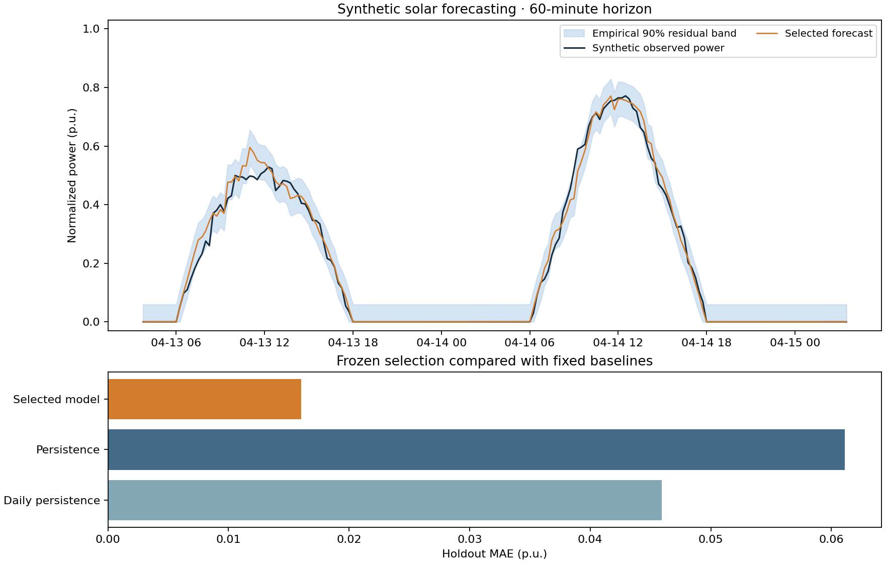
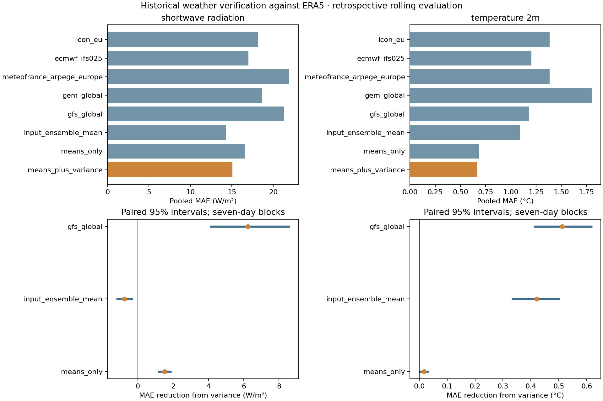
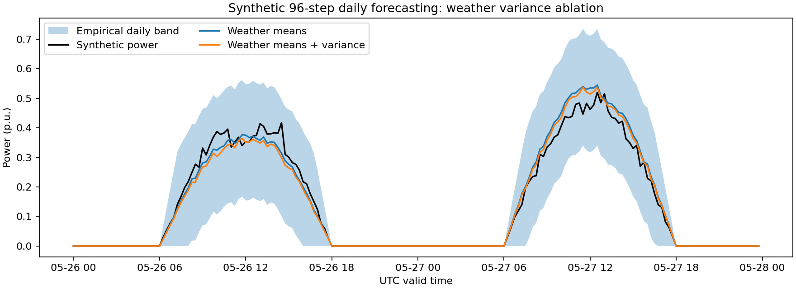

# Solar Forecast Analysis

[](https://github.com/jorge-barb-pereira/DS-solar-forecast-analysis/actions/workflows/forecast.yml)

An independently written portfolio demonstration of solar-power forecasting, weather-model variance and chronological evaluation. **Power observations and power-forecast results are synthetic.** A separate historical weather study uses public forecasts and ERA5 reanalysis, with sanitized aggregate results published below. The default experiments run offline; live acquisition uses location settings supplied locally.

This edition was developed in **October 2026**. It demonstrates general forecasting methods; it does not reproduce an operational installation, a deployment or measured forecasting performance.

## What it demonstrates

- Four named weather-model inputs, explicit sample variance in ML, and a controlled three-member comparison against historical ERA5 data.
- Reproducible normalized power series at 15-minute intervals.
- Issue-time feature availability, lagged observations and rolling summaries.
- Persistence and daily-persistence baselines, scaled Ridge regression and histogram gradient boosting.
- Chronological training, validation, calibration and test periods with target-boundary purging.
- Validation-only selection, a separate empirical forecast-error band and a frozen final holdout evaluation.
- Explicit error units, baseline skill and tests for future-data leakage.
- Optional Open-Meteo calls for current forecasts, previous-day offsets and archived individual model runs, including weather-model comparisons.
- A separate 96-step daily forecasting study using previous-day/week profiles and weather-model variance, with an explicit variance-feature ablation.
- A historical weather benchmark against ERA5, with GFS excluded from fitting and tuning, rolling-origin evaluation and paired block-bootstrap intervals. Raw downloads and location settings stay local.



## Run the demonstration

Requires Python 3.11 or newer. From the repository root:

```bash
python -m venv .venv
# Windows PowerShell: .venv/Scripts/Activate.ps1
# Linux/macOS: source .venv/bin/activate
python -m pip install -e .
python -m unittest discover -s tests -v
python tools/check_publication.py
python -m solar_forecast
```

The default experiment generates 120 fictional days and forecasts four 15-minute steps ahead. Optional flags: `--days`, `--seed`, `--horizon` (1–96 steps), and `--output`.

Outputs are `synthetic-series.csv`, `forecast.csv`, `metrics.json` and `forecast-analysis.png` under ignored `output/`. All timestamps belong to an invented series beginning in 2050. Power is in per-unit values from 0 to 1, not measured kW or inferred equipment capacity. The command does not import an external dataset or deserialize a saved model.

## Repository map

For live weather downloads, see [Open-Meteo setup and interpretation](docs/OPEN_METEO.md). That workflow exports only selected weather variables and safe provenance under ignored `output/`; it does not use real power measurements or change the synthetic benchmark.

For real archived weather, run `python -m solar_forecast.history --start-date 2025-01-01 --end-date 2025-12-31` with local location settings. See the [historical evaluation protocol](docs/HISTORICAL_BENCHMARK.md). This evaluates weather against reanalysis; it does not establish real PV-power accuracy.

**[Read the four-model historical results](docs/HISTORICAL_RESULTS.md)** and [study scope / endpoint selection](docs/STUDY_SCOPE.md). The primary ensemble uses ICON-EU, ECMWF IFS, ARPEGE Europe and GEM Global, with a controlled three-member sensitivity. Across 201 rolling test days, adding variance lowers trained-model radiation MAE, while the simple four-member average remains better. These are retrospective weather-verification findings, not measured PV validation.



For the daily multi-output study, run `python -m solar_forecast.day_ahead`. It **uses inter-model variance as a forecasting input** and compares against the same model without variance. See [daily methods, normalization and limitations](docs/DAY_AHEAD.md) and the [fixed synthetic report](docs/results/day-ahead.json).



| Path | Purpose |
| --- | --- |
| `src/solar_forecast/data.py` | Synthetic signal and strict timestamp/value checks |
| `src/solar_forecast/features.py` | Causal features and chronological partitions |
| `src/solar_forecast/study.py` | Baselines, selection, error metrics and residual bands |
| `src/solar_forecast/open_meteo.py` | Optional public weather API adapter with local settings |
| `src/solar_forecast/ensemble.py` | Reusable inter-model means, variances, standard deviations, ranges and pairwise differences |
| `src/solar_forecast/day_ahead.py` | Daily multi-output study, variance ablation and daily uncertainty bands |
| `src/solar_forecast/history.py` | Optional historical weather post-processing and excluded-model comparison |
| `src/solar_forecast/robustness.py` | Rolling origins, paired circular-block intervals and aggregate public reporting |
| `tests/` | Analytic checks, causality perturbations and full synthetic experiment |
| `docs/` | Methods, synthetic power results and sanitized historical weather results |
| `tools/` | Public-file allowlist and artifact checks |

## Interpretation

At each issue time the current and previous power observations are available; predictions target a later timestamp. Held-out periods therefore simulate repeated rolling forecast issuance with newly arriving observations, not an entire period forecast from a single origin. No future measured weather is used as if it were an available forecast.

The generator uses a fixed fictional daily envelope and correlated random variability, not a physical solar-position model. Results on it demonstrate software behavior rather than real-world forecast accuracy. The uncertainty band is empirical; temporal dependence prevents a distribution-free coverage guarantee. See [methods and limitations](docs/METHODS.md), [validation](docs/VALIDATION.md) and [publication scope](docs/PUBLICATION_SCOPE.md).
