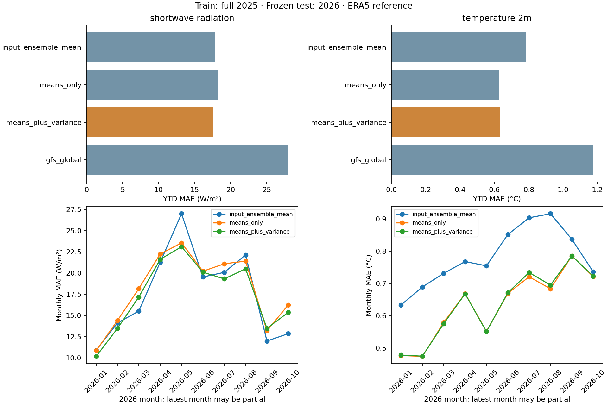

# Train on 2025, test on 2026

Four-model mean/variance post-processing of archived weather forecasts, verified against ERA5 reanalysis. This is not measured PV-power validation. Location values and raw hourly inputs/predictions remain local.

Training uses all **8,760 hourly records from 2025**. Four expanding folds entirely within that year select each estimator, which is refitted on all training-year rows and frozen. No test-year labels enter selection, scaling or fitting.

The calendar holdout spans **2026-01-01 to 2026-10-12**, with **285 days / 6,840 hours**. Status: Year-to-date; not a complete test year. The end date is the last complete day in the evaluated dataset; a supplied cache is not checked for newer provider data.

Inputs are ICON-EU, ECMWF IFS 0.25°, ARPEGE Europe and GFS Global. Variance is computed independently at each valid hour across the four members (sample variance, ddof=1). GFS is an input member and is also scored as a raw-model baseline; ERA5 is the verification reference. The estimator menu is unchanged: three scaled Ridge alpha values and fixed histogram gradient boosting.

The earlier within-2025 study uses GEM Global and excludes GFS. This cross-year study replaces GEM with GFS because GEM has internal 2026 archive gaps; JMA GSM also lacks required radiation. The choice used field completeness before test errors were examined. All 2025 fitting uses the same four members as 2026 prediction; earlier scores are not a controlled before/after comparison.

## Frozen 2026 scores

| Method | Radiation MAE (W/m²) | Temperature MAE (°C) |
| --- | ---: | ---: |
| icon_eu | 23.1791 | 1.1503 |
| ecmwf_ifs025 | 17.9507 | 1.1545 |
| meteofrance_arpege_europe | 28.3854 | 1.2526 |
| gfs_global | 27.9392 | 1.1728 |
| input_ensemble_mean | 17.8851 | 0.7858 |
| means_only | 18.2953 | 0.6280 |
| means_plus_variance | 17.5962 | 0.6306 |

## Paired differences

Positive MAE reduction favors the variance model. When at least 14 test days are available, approximate 95% intervals use 2,000 paired circular daily-block replicates, seven-day blocks and seed 42. The JSON also includes 1-, 3- and 14-day sensitivity. Shorter studies omit intervals. These are conditional, marginal intervals; seasonal nonstationarity and the artificial circular end-to-start join limit interpretation.

| Variable | Comparator | MAE reduction | Approximate 95% interval |
| --- | --- | ---: | --- |
| shortwave_radiation | means_only | 0.6991 | [0.2995, 1.1740] |
| shortwave_radiation | input_ensemble_mean | 0.2889 | [-0.6097, 1.1729] |
| shortwave_radiation | gfs_global | 10.3430 | [7.3889, 13.2054] |
| temperature_2m | means_only | -0.0026 | [-0.0060, 0.0006] |
| temperature_2m | input_ensemble_mean | 0.1552 | [0.1192, 0.1889] |
| temperature_2m | gfs_global | 0.5422 | [0.4373, 0.6541] |

## Availability and interpretation

Calendar holdout starts January 1. Full previous-year ERA5 labels arrive with delay, so the separate January 8-onward subset is the availability-buffered evaluation. Neither reconstructs an exact operational release-time ledger.

The January 8-onward scores, monthly scores (with partial-month counts), positive-reference radiation scores, model choices, fold boundaries and package versions are in the aggregate JSON. ERA5 is retrospective and can be revised. Weather providers can change model versions between years; this is part of the cross-year generalization challenge, not evidence of a fixed model climate.

The design uses only 2025 for development and does not adapt to 2026 outcomes. It remains a retrospective evaluation, not a prospectively registered deployment. One location, one training year and an incomplete test year limit generalization. Variance is a point-forecast predictor, not a calibrated uncertainty estimate.

[Aggregate results](results/yearly-2025-2026.json) · [Study scope and endpoints](STUDY_SCOPE.md) · [Earlier within-2025 study](HISTORICAL_RESULTS.md). Weather data by [Open-Meteo](https://open-meteo.com/) (CC BY 4.0); [historical reference and attribution](https://open-meteo.com/en/docs/historical-weather-api).
